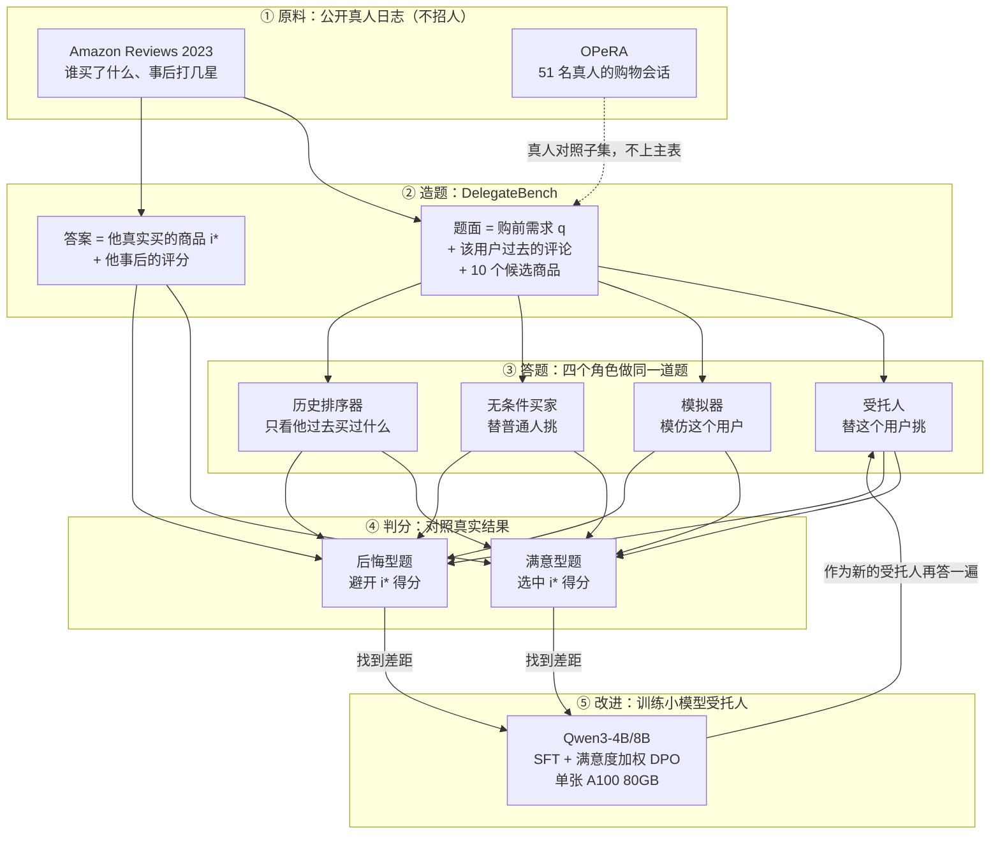
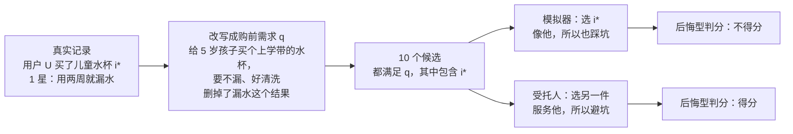
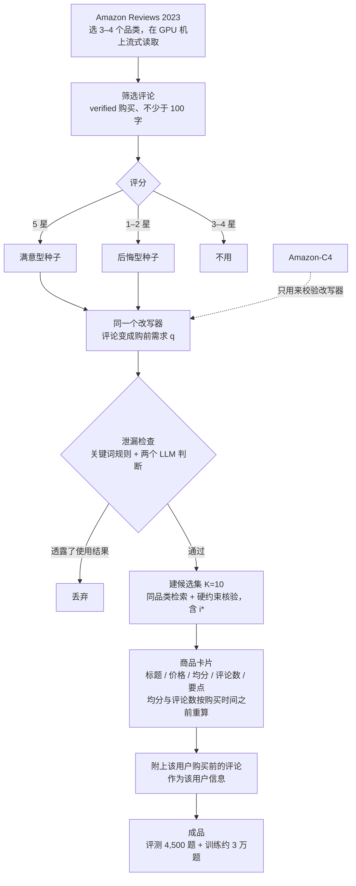
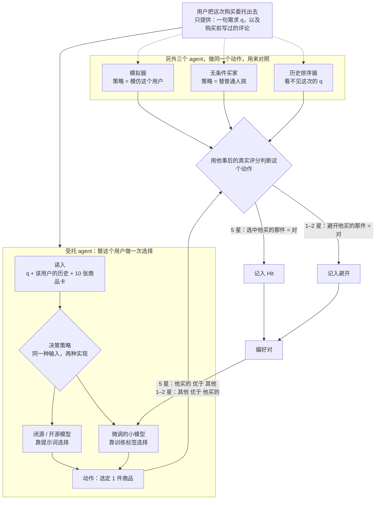
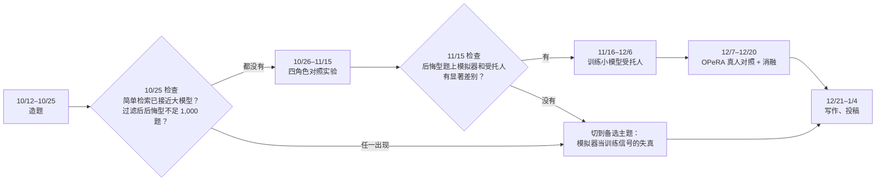

# 论文方案流程图

> 日期：2026-10-10 | 从对话整理，换电脑后从这里继续
> 配套：[01 调研](01_ACL2024-2026_Agent+RecSys_调研.md)、[02 Proposal](02_ACL2027_Proposal_DelegationGap.md)、[03 主题界定](03_主题界定.md)、[04 选题与计划](04_ACL2027_候选主题排序.md)、[05 参考论文操作对照](05_参考论文操作对照.md)
> 投稿截止：ARR **2027-01-04**。训练机：单张 A100 80GB（老师意见）；5090 只做调试。闭源 API 有预算。不招人、不做问卷。

## 当前结论（继续分析前先看这段）

论文只做一件事：用户把一次购物交给 agent 之后，agent 选中的商品是不是**这个用户**会满意的那一个。5 星的真实购买应当选中，1–2 星的真实购买应当避开。

创新不在造题、DPO、真人日志、打乱位置这些零件（分别来自 BLaIR、Mirroring Users / RecPO / T-PRA、OPeRA、ACES）。创新在标签：低分购买上，和用户一致算错。微调的小模型是按这个标签训练出来的**受托策略**，不是评测器，也不是用户模拟器。

若前沿模型在后悔型题上本来就会避开，创新不成立。检查点是 11 月 15 日。

---

## 图 1　整体架构

原料是公开日志。四个角色答同一道题。小模型训练完之后，回到「受托人」这个角色再答一遍。

要证明的对比在第 ④ 步：后悔型题上，模拟器会跟着用户一起踩坑，好的受托人应该避开。

---

## 图 2　一道后悔型题（示意，不是真实数据）

满意型题的构造相同，来源换成 5 星评论，这时选中 i\* 才得分。

---

## 图 3　题目怎么造

满意型和后悔型用同一个改写器。Amazon-C4 全部是 5 星、没有逐条候选，只用来校验改写器，不当主数据。不需要人工标注，作者只抽看约 50 条。

四个角色：

| 角色 | 看到什么 | 满意型题上该怎样 | 后悔型题上该怎样 | 由谁来当 |
|---|---|---|---|---|
| 受托人 | 需求 q + 该用户历史 | 选中 i\* | 避开 i\* | 闭源模型 ×2、开源模型、本文训练的小模型 |
| 模拟器 | 该用户历史 | 选中 i\* | 也选 i\*（复现踩坑） | UserMirrorer-3B |
| 无条件买家 | 只有品类和候选 | 不一定选中 | 不一定避开 | 闭源模型 ×2、开源模型 |
| 历史排序器 | 只有历史，没有 q | 可能选中 | 可能继续踩坑 | SASRec / 历史-only LLM |

闭源模型只放在「受托人」和「无条件买家」两行：两家厂商，全部 4,500 题，分有无该用户历史，每题打乱顺序 3 次。先跑约 200 题实测费用。

---

## 图 4　从 agent 的角度看：小模型在哪

用户只把需求和购买前的评论交出来。受托 agent 的动作永远是「选定 1 件」。闭源模型和小模型是**同一种策略的两种实现**，输入输出相同。小模型出现两次：训练时吃反转后的偏好对；考完后放回策略位置重答。

小模型不是新架构。它用来证明：差距可以被训练目标关掉，而不是只能靠更大的闭源模型。模拟器的标签不反转，所以它会在低分样本上继续选中原商品。

---

## 图 5　小模型怎么训

在单张 A100 80GB 上用 LoRA 做 SFT 和 DPO，不做强化学习。

```mermaid
flowchart TB
    T["训练集约 3 万题"] --> SFT["第 1 步 SFT<br/>强模型在已知答案的情况下写选择理由，<br/>小模型学：读需求、比候选、选一件"]
    SFT --> PAIR{"第 2 步：按真实评分造偏好对"}
    PAIR -->|满意型| P1["i* 优于一个难负例"]
    PAIR -->|后悔型| P2["最佳替代品 优于 i*<br/>满足 q、购买时间前均分最高的另一件"]
    P1 --> DPO["满意度加权 DPO<br/>评分离 3 星越远，权重越大"]
    P2 --> DPO
    AUG["同一题的扰动副本<br/>打乱位置 / 给干扰项加 Sponsored"] --> REGU["一致性正则<br/>扰动前后应选同一件"]
    REGU --> DPO
    DPO --> OUT["训练好的受托人<br/>放回图 4 的策略位置重新答题"]
```

---

## 图 6　时间线和两个切换点

一个人只做一篇。两个检查点都是在问这道题还值不值得做。

- **10 月 25 日**：简单检索就能做对，说明题太容易；后悔型过滤后不足 1,000，说明数据撑不住。
- **11 月 15 日**：模拟器和受托人在后悔型上没差别，说明「受托人不等于模拟器」不成立，小模型也没有可关的差距。

切到备选主题时的最小版本：多个模拟器给同一批推荐系统排序，看排序是否一致；再用 best-of-n 加大对模拟器的优化强度，看真实对话上的成绩是否下降。不做 GRPO。数据用 ReDial、INSPIRED、Reddit-Movie。详见 04 号文档第 3.2 节。

---

## 图和论文章节的对应

| 论文章节 | 回答的问题 | 图 |
|---|---|---|
| 问题定义 | 什么叫替这个用户选对 | 图 2、图 4 |
| DelegateBench | 题目从哪来、怎么防泄漏 | 图 3 |
| 测量实验 | 前沿模型差多少；模拟器和普通买家为什么也不行 | 图 1 的 ③④、角色表 |
| 方法 | 用真实满意度训练小模型 | 图 4、图 5 |
| 分析 | 有没有该用户历史、Sponsored 标签拉偏多少 | 角色表的两种条件 |
